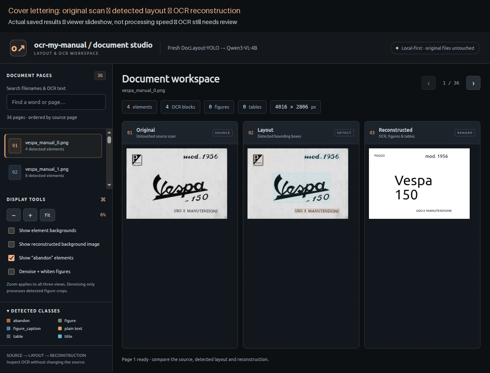
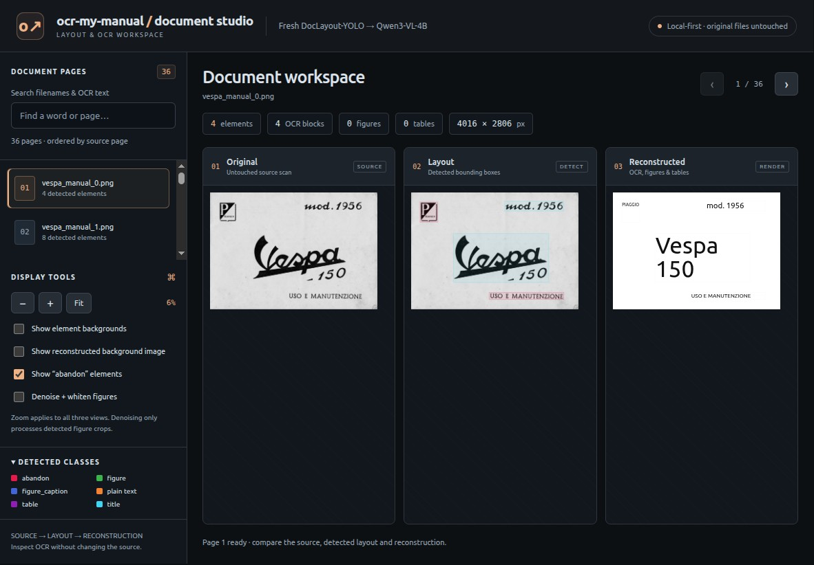
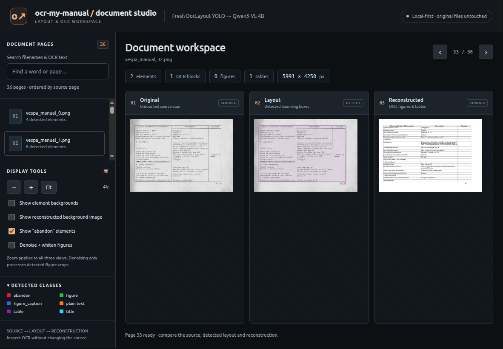

# ocr-my-manual

Convert a scanned PDF or a folder of photos into a searchable, static document
viewer using **DocLayout-YOLO → Qwen3-VL OCR → HTML reconstruction**.

The Python package remains `vespa_retrieval`; the existing Vespa manual is sample
content, not the project branding. CLI help uses `ocr-my-manual` as its display
name; invoke it with `python main.py` as shown below.

## See it in action



*Actual screenshots from the saved Vespa sample results. This is a viewer
slideshow, not a real-time recording of detection/OCR; frame duration does not
represent processing speed. OCR errors remain visible rather than being manually
corrected for the demo.*

### Original → layout → reconstruction



The three synchronized panels let you compare the source scan, detected regions
and reconstructed content. The stylized title reads “Vespa 150”; the small emblem
letter is still missing from this OCR result.



Tables are rendered as HTML with visible borders. This example illustrates the
repaired table structure; it is not a guarantee of exact transcription or row alignment.
See the [full body-text screenshot](docs/media/viewer-text.jpg) or open the
[interactive sample viewer](docs/qwen_pipeline/index.html).

## Tested hardware and speed

On an **RTX A5000 Laptop GPU (16 GiB VRAM)** with an i9-11950H and 62.51 GiB RAM:

- Sampled peak Qwen inference VRAM: **7185 MiB (7.02 GiB)** whole-device usage.
- Sampled peak process-tree RAM: **4.33 GiB at model startup**, **2.76 GiB during
  the largest tested OCR request**; detection peaked at **1.61 GiB**.
- Fresh CPU layout detection: **36 pages in 68.68 s**, averaging **1.91 s/page**.
- OCR examples: **2.24 s** for the logo, **3.60 s** for a paragraph, and
  **14.14–23.88 s** for two tables; generation approximately **60–65 tokens/s**.

These are measured observations, **not minimum requirements**. Only the 16 GiB GPU
was tested; smaller cards and CPU-only OCR were not validated. See
[tested requirements, methodology and raw evidence](docs/guides/HARDWARE_AND_PERFORMANCE.md)
for exact versions, scenarios, memory definitions and caveats.

## Installation and execution

Use Python 3.10+ with the dependencies in [requirements.txt](requirements.txt).
A working PyTorch installation is required for layout detection. Install the
dependencies into the Python environment you intend to use.

```bash
python -m pip install -r requirements.txt
python main.py /path/to/manual.pdf
python main.py /path/to/photos --output outputs/my-manual
```

PDFs are rendered in page order at 200 DPI by default. A photo folder is processed
in **alphabetical filename order** (case-sensitive, not natural numeric order):
`photo_10.jpg` precedes `photo_2.jpg`. Zero-pad filenames if you want numeric page
order. Supported photos: PNG, JPG/JPEG, WebP, TIFF/TIF and BMP. Subfolders are not
recursed. EXIF orientation is applied to staging copies; source files are untouched.

The entry point automatically starts the local native llama-server with a
Qwen3-VL-4B decoder and companion projector, waits for readiness, then stops it
after OCR, including on failure. Model weights, the llama.cpp checkout and its
compiled server are large local runtime assets and are not included in this
repository; provide compatible files at these paths or use the command-line
options below. No model downloads are automatic for OCR. Default paths are:

- Server executable under `vendor/llama.cpp/build/bin/`.
- Qwen Q8_0 decoder and f16 vision projector under `models/logo_ocr/`.

For a different installation, supply `--server-binary`, `--ocr-model` and
`--projector`, or connect to an already-running compatible server:

```bash
python main.py /path/to/manual.pdf --endpoint http://127.0.0.1:8003/v1/chat/completions
```

The existing server must expose the `qwen3vl4b` model alias. Other useful options:
`--dpi`, `--detector-model` (local checkpoint or HF repository), `--port`, and
`--output`. Run `python main.py --help` for all options.

## Results

By default, each run creates a new timestamped directory under `outputs/`. An
explicit `--output` must not already exist and must not be inside the photo input
folder. This avoids overwriting another manual or accidentally mixing runs.

```text
outputs/<run>/
  input_manifest.json       Original filename/PDF-page → staged page mapping
  pipeline_manifest.json    Run status and configuration
  originals/                Normalized input scans
  layouts/                  Annotated detections
  layouts.json              Combined detections
  crops/                    Unmodified detected crops
  layout_documents/         Per-page OCR documents
  layouts_with_texts.json    Combined OCR output
  ocr_audit.json             Raw model responses
  logs/                     Detector and optional model-server logs
  site/                     Self-contained viewer and copied assets
```

Open the generated site entry page in your browser. For manual publishing, copy
the **entire site directory**, not only its HTML file. No backend, GPU, model
weights or Python environment is needed to view the generated website. Scans are
included in the site: only publish material you intend to make public.

If detection or OCR fails, the command exits nonzero, records failure details and
keeps checkpoints/logs; it does not advertise a completed site. Normal generation
completion is not proof of OCR accuracy—review tables and small text against scans.

## Project organization

```text
main.py                    Single full-pipeline entry point
vespa_retrieval/            Runtime package
  inputs.py                PDF rendering and alphabetical photo staging
  pipeline.py              Orchestration
  server.py                Local OCR process lifecycle
  detect_layout.py         Layout detection
  run_qwen_layout_ocr.py    Crop OCR and checkpoints
  build_ui.py              Static website generation
  repair_qwen_tables.py    Optional specialized table retries
  ocr_backends.py           Model HTTP client
  pipeline_utils.py        Shared image/checkpoint utilities
  table_html.py            Shared table processing
  templates/               Viewer HTML template
tools/                     Optional evaluation and historical OCR scripts
tests/                     Python and browser-UI regressions
docs/                      Existing viewers and detailed guides
imgs/, models/, outputs/   Local inputs, model files and generated results
vendor/                    Local llama.cpp checkout (not tracked)
```

Individual utilities now use package execution, not loose root scripts:

```bash
python -m vespa_retrieval.build_ui --help
python -m vespa_retrieval.run_qwen_layout_ocr --help
python -m vespa_retrieval.repair_qwen_tables --help
python -m tools.benchmark_ocr --help
```

Specialized table repair is for three-column Italian troubleshooting tables;
it is deliberately not applied automatically to arbitrary input tables.

## Tests and existing results

```bash
python -m unittest discover -s tests -p 'test_*.py'
node --test tests/test_ui.cjs
```

Tests use temporary fixtures and mocked model requests; PDF rasterization is real.
Both photo-folder and PDF full-pipeline smoke runs have also been executed with
the real detector and Qwen model on this machine.

- [Current Vespa viewer](docs/qwen_pipeline/index.html)
- [Workflow details](docs/guides/PIPELINE_WORKFLOW.md)
- [Qwen run and table-repair notes](docs/guides/QWEN_PIPELINE.md)
- [Earlier OCR evaluation](docs/guides/OCR_EVALUATION.md)
- [Cover/logo OCR evaluation](docs/guides/LOGO_OCR_EVALUATION.md)
- [Historical README](docs/guides/LEGACY_README.md)

## Historical notes

> The appended notes below are historical, not the current workflow. Root-script
> commands are superseded by the package commands above. The complete original
> historical README is preserved in [the legacy guide](docs/guides/LEGACY_README.md).

Convert a scanned PDF or a folder of photos into a searchable, static document
viewer using **DocLayout-YOLO → Qwen3-VL OCR → HTML reconstruction**.

The Python package remains `vespa_retrieval`; the existing Vespa manual is sample
content, not the project branding. CLI help uses `ocr-my-manual` as its display
name; invoke it with `python main.py` as shown below.

## Run the full pipeline

Use Python 3.10+ with the dependencies in [requirements.txt](requirements.txt).
A working PyTorch installation is required for layout detection. Install the
dependencies into the Python environment you intend to use.

```bash
python -m pip install -r requirements.txt
python main.py /path/to/manual.pdf
python main.py /path/to/photos --output outputs/my-manual
- [Cover/logo OCR evaluation](docs/guides/LOGO_OCR_EVALUATION.md)
```
## Run the script
 ```
 python ocr_query.py 
 ```

Put your original scanned manual images in the `imgs/` folder before building the browser UI. Supported file types include `.png`, `.jpg`, `.jpeg`, `.webp`, `.tif`, and `.tiff`.

1. Build the site. This reads `outputs/layouts_with_texts.json` and writes a
   self-contained, static site to `docs/` (relative asset paths, table HTML
   embedded inline, `originals/` and `crops/` copied alongside `index.html`):
   ```
   python build_ui.py
   ```
   > If you get `outputs/layouts_with_texts.json not found`, run the pipeline first:
   > `python detect_layout.py` → `python layout_to_doc.py` → `python build_ui.py`.

2. Preview locally. Because the site is self-contained you can just open
   `docs/index.html` in your browser, or serve the `docs/` folder:
   ```
   python -m http.server 8080 --directory docs
   ```
   then open `http://localhost:8080/`.

Pick a page from the sidebar to load it. Use the zoom buttons and the checkboxes
to toggle the element backgrounds and the reconstructed background image.

## Publish it as a GitHub Pages website

The generated `docs/` folder is ready to host on GitHub Pages:

1. Commit and push the `docs/` folder (including `docs/originals/`,
   `docs/crops/` and `docs/index.html`) to your `main` branch:
   ```
   git add docs
   git commit -m "Add static layout viewer site"
   git push
   ```
2. In your repository on GitHub, go to **Settings → Pages**.
3. Under **Build and deployment → Source**, choose **Deploy from a branch**.
4. Set the branch to **main** and the folder to **/docs**, then **Save**.
5. After a minute the site is live at
   `https://<your-username>.github.io/<your-repo>/`.

The page uses only relative paths and embeds table HTML inline, so it works
correctly under the `/<your-repo>/` sub-path that GitHub Pages serves from.
Re-run `python build_ui.py` whenever the pipeline output changes, then commit
the updated `docs/` folder.

## Pipeline reference

The end-to-end flow, from scanned images to the static layout viewer:

```
imgs/*.png
  └─ detect_layout.py      → outputs/layouts/ (+ layouts.json)   [DocLayout-YOLO boxes]
       └─ ocr_query.py     → outputs/ocr_results.json            [dots.ocr transcription]
            └─ layout_to_doc.py → outputs/layouts_with_texts.json [text per element/crop/table]
                 ├─ build_ui.py             → docs/ (static viewer site)
                 └─ build_reconstructed_pdf.py → reconstructed PDF/preview
```

### Local dots.ocr server

The OCR step (`ocr_query.py`) expects a **dots.ocr** vision server exposing an
OpenAI-compatible API on port 8000. Run it with llama.cpp:
```
docker run --rm --gpus all -p 8000:8080 -v "$(pwd)/models":/models \
  ghcr.io/ggml-org/llama.cpp:server-cuda --hf-repo ggml-org/Dots.OCR-GGUF --gpu-layers 999
```

### Tests

Standard-library unit tests live in `tests/`:
```
python -m unittest discover -s tests -v
```
They cover the reconstructed-PDF render targets.

### Repository layout

| Path | Purpose |
|---|---|
| `detect_layout.py` | DocLayout-YOLO element detection |
| `ocr_query.py` | dots.ocr transcription of pages/crops |
| `layout_to_doc.py` | Merge detections + OCR into structured docs |
| `build_ui.py` / `ui_template.html` | Static layout viewer site (`docs/`) |
| `build_reconstructed_pdf.py` | Rebuild a readable PDF/preview from the layout |
| `tests/` | Standard-library unit tests |
| `requirements.txt` | OCR + layout pipeline dependencies |

For the newer-model experiment and safe candidate workflow, see [OCR_EVALUATION.md](docs/guides/OCR_EVALUATION.md).


