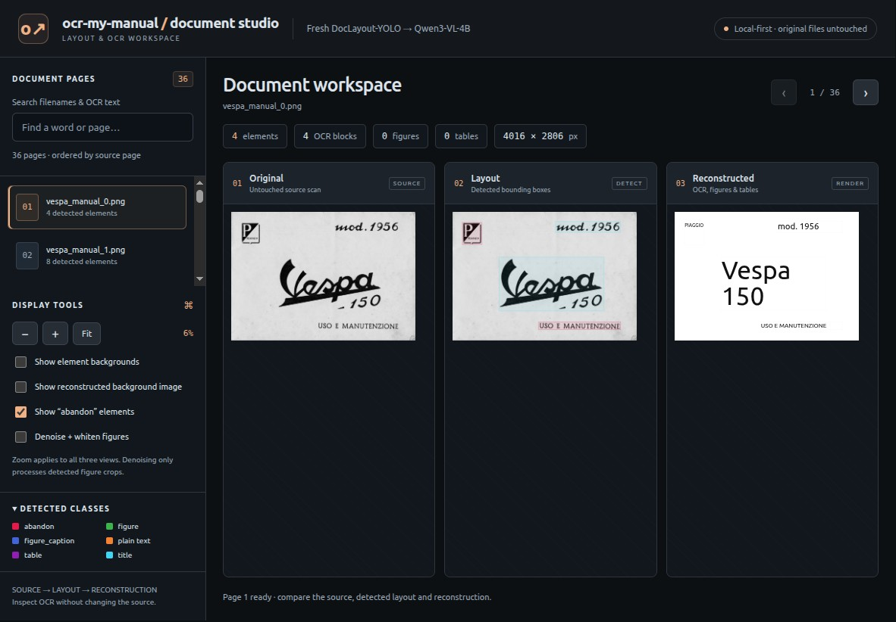

# ocr-my-manual: tested hardware and performance

Measured **2026-10-31**, after renaming the project folder. These are observations
on one machine and one workload, **not certified minimum hardware requirements**.

## Tested configuration

| Item | Tested value |
| --- | --- |
| GPU | NVIDIA RTX A5000 **Laptop** GPU, 16,384 MiB VRAM (16 GiB) |
| NVIDIA driver | 580.178.04 |
| CPU | Intel Core i9-11950H, 8 cores / 16 logical CPUs |
| Physical RAM | 64,006 MiB (62.51 GiB) |
| OS | Ubuntu 22.04.5 LTS, Linux 6.8.0-138-generic, x86-64 |
| Python | 3.11.14, existing OCR-trial environment |
| PyTorch | 2.9.1+cu128 |
| Detector | doclayout-yolo 0.0.4, DocStructBench checkpoint, **CPU inference** |
| Image/PDF libraries | Pillow 12.0.0, NumPy 2.3.5, PyMuPDF 2.0 |
| Native OCR runtime | llama.cpp 0.4.0-dev b124 e71b805, CUDA |
| OCR weights | Qwen3-VL-4B-Instruct Q8_0 decoder + f16 vision projector |
| Serving options | 8192-token context, one slot, 99 GPU layers, flash attention |
| OCR decoding | Temperature 0, top-p 1, seed 42; 4096 text / 6144 table output budget |

The decoder and projector occupy about **4.77 GiB on disk**. Weight-file size is
not the VRAM requirement: vision encoding, context/KV cache and compute buffers
also consume memory. The exact model hashes are preserved in the
[Qwen run manifest](../../outputs/qwen_pipeline/run_manifest.json).

## Test scenario



The sample viewer above illustrates the same manual used for measurements.
The [animated viewer demonstration](../media/viewer-demo.gif) cycles through saved
cover, body-text and table pages; its playback timing is unrelated to inference time.

1. **Fresh layout detection on all 36 sample Vespa manual scans**, yielding 239
   deduplicated regions. The cover is 4016 × 2806; remaining scans are approximately
   5983–6008 × 4158–4275 pixels. Detector inference size: 1024, confidence 0.25,
   deduplication IoU 0.20. Checkpoint already cached: no download timing included.
2. **Fresh native Qwen server startup**, with no model server previously running.
   OS file caches were not flushed, so this is not a disk-cold loading benchmark.
3. **Four sequential OCR requests on unchanged, previously detected crops**:
   stylized logo, an Italian paragraph, a lubrication table and a troubleshooting
   table. Standard production text/table prompts were used; no table-repair image
   reduction was used in this benchmark. Each returned a normal `stop` completion.

This isolates detection, startup and OCR. It is **not a full 36-page OCR throughput
test**, nor a timed PDF-to-site run. Existing complete PDF/photo smoke tests passed,
but PDF rasterization and site generation have not been separately profiled here.

## Observed memory occupation

| Phase | Sampled peak process-tree RSS | Sampled peak whole-device VRAM |
| --- | ---: | ---: |
| Detection, CPU | 1646 MiB (1.61 GiB) | 18 MiB (unchanged baseline) |
| Qwen server startup | 4429 MiB (4.33 GiB) | 6659 MiB (6.50 GiB) |
| Logo OCR | 1213 MiB (1.18 GiB) | 6915 MiB (6.75 GiB) |
| Paragraph OCR | 1638 MiB (1.60 GiB) | 6915 MiB (6.75 GiB) |
| Lubrication table OCR | 2104 MiB (2.05 GiB) | 7183 MiB (7.01 GiB) |
| Troubleshooting table OCR | 2823 MiB (2.76 GiB) | **7185 MiB (7.02 GiB)** |

**Inference VRAM peak observed: 7185 MiB total device usage**, or approximately
7167 MiB above the 18 MiB idle baseline. The VRAM value includes the desktop and
all GPU allocations; no other compute workload was running. GPU usage returned
to 18 MiB after server shutdown.

RAM is summed resident memory (RSS) of the benchmark process and descendants,
including the detector subprocess or native server. It is **not total host RAM
usage**, private/unique memory, or a measurement of the standard entry-point
process in isolation. Shared/mapped pages can be counted more than once. Startup
RAM can exceed later inference RAM as model mappings change.

## Processing speed

### Layout detection

- **68.68 seconds** for 36 pages, including Python/model loading, preprocessing,
  inference, deduplication, annotated-image writes and metadata writes.
- Mean end-to-end detection: **1.91 seconds/page**, approximately **31.45 pages/min**.
- Detector-reported model inference only: **824 ms/page average**, range
  **621–922 ms**; summed model inference **29.68 seconds** for 36 pages.
- Detector does not use the GPU in the current pipeline.

### OCR

Native server startup to health-ready: **3.03 seconds** (warm OS file cache).

| Crop | Dimensions | Output tokens | HTTP OCR duration | Native generation speed |
| --- | ---: | ---: | ---: | ---: |
| Stylized cover logo | 2287 × 1179 | 8 | 2.24 s | 61.20 tokens/s |
| Body paragraph | 4715 × 386 | 139 | 3.60 s | 64.63 tokens/s |
| Lubrication table | 5032 × 3025 | 619 | 14.14 s | 60.25 tokens/s |
| Troubleshooting table | 5102 × 3315 | 1184 | 23.88 s | 59.91 tokens/s |

The four HTTP requests total **43.86 seconds**; their mean is not a useful
whole-manual estimate because text length/table complexity differ substantially.
HTTP time includes image encoding on the server, prompt evaluation and decoding;
client image-file/base64 preparation precedes that timer. Native tokens/s describes
**generation only**, not image processing or complete request throughput.
The first request had no cached tokens; subsequent requests reused only four
common prefix tokens. There was no full-image response reuse.

## Practical requirements and limits

- **Known-tested hardware:** the 16 GiB NVIDIA laptop GPU above. No 8 GiB/12 GiB
  GPU or CPU-only OCR run was tested. The measured ~7.02 GiB peak does **not** prove
  an 8 GiB card is sufficient for every page, context size or driver/runtime build.
- For the default full-offload configuration, reserve VRAM above the measured
  peak and account for other GPU applications. A **12–16 GiB GPU is a conservative
  planning recommendation**, not a measured minimum; 16 GiB is verified here.
- Allow RAM above the measured 4.33 GiB startup RSS plus OS/other applications,
  document staging and file caches. **16 GiB host RAM is a planning recommendation**;
  only this 62.51 GiB machine was tested, and neither 8 nor 16 GiB was validated.
- A CUDA-enabled native llama-server and compatible NVIDIA driver are required
  for the tested local OCR path. Layout detection itself runs on CPU. The static
  viewer requires no GPU/server at all.
- Larger images, larger contexts, concurrent slots, retries and long outputs can
  increase memory/time. Output limits and structurally valid HTML do not guarantee
  accurate transcription. Review tables against the scans.
- OCR weights/native server are separate from Python dependencies. The base conda
  installation on this machine has broken PyTorch; use the working environment.

## Evidence and reproduction

- [Raw samples, image hashes, prompts, requests, outputs and native timings](../../outputs/resource_benchmark_20261031_verified/results.json)
- [Full layout log](../../outputs/resource_benchmark_20261031_verified/logs/layout.log)
- [Native OCR server log](../../outputs/resource_benchmark_20261031_verified/ocr_server.log)
- [Repeatable resource benchmark](../../tools/benchmark_resources.py)

From the project root, install optional tool requirements if needed and run:

```bash
python -m pip install -r tools/requirements.txt
python -m tools.benchmark_resources --output outputs/my-resource-benchmark
```

This benchmark intentionally uses the existing Vespa scans and crops; it is a
reproducible diagnostic fixture, not an arbitrary-input benchmark. Output must be
a new directory. Sampling waits 250 ms between polls **plus** `nvidia-smi` overhead;
therefore reported peaks are sampled observations and short-lived spikes may be
missed. Monitor overhead is included in wall-clock measurements. One run only:
no repeated-run confidence interval, power normalization or thermal control.

The first attempt after renaming failed before OCR because the native executable
embedded its old build-directory RUNPATH. Local startup now adds the executable's
directory to `LD_LIBRARY_PATH`; the successful run above verifies that relocation
fix. Vendor binaries were not modified.